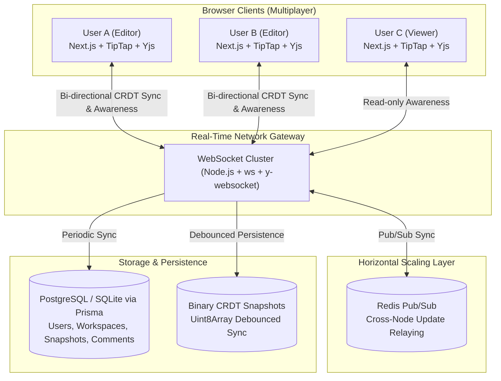
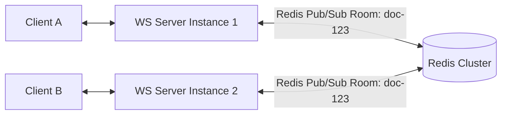

# System Architecture & Technical Specifications
## Project FS-02: Real-Time Collaborative Workspace

---

## 1. High-Level System Architecture

---

## 2. Deep Dive: CRDTs (Conflict-Free Replicated Data Types) vs. Operational Transformation (OT)

### The Collaboration Dilemma
When multiple users edit a document simultaneously:
* **User A** types `"World"` at index 5.
* **User B** types `"Hello "` at index 0.

If both operations are broadcast naively, indices shift, leading to scrambled text, duplicate characters, or document corruption.

### Operational Transformation (OT)
* Used by Google Docs.
* Relies on a **centralized server authority** to serialize every single keystroke.
* When concurrent edits arrive, the server transforms the character offsets using mathematical matrices and broadcasts transformed operations back to clients.
* **Drawbacks**: Complex state-space exploration algorithms, high server CPU overhead, failure-prone during offline-first scenarios or network partitions.

### CRDTs (Conflict-Free Replicated Data Types) — Our Implementation
* Used by modern multiplayer platforms (Figma, Notion, Apple Notes).
* **Yjs** implements a state-based CRDT where the document is represented as a doubly-linked list of items with unique identifiers: `(clientID, clock)`.
* Every character or block has an immutable identifier that never changes regardless of deletions or insertions around it.
* **Mathematical Properties**:
  * **Commutative**: $A \circ B = B \circ A$ (order of arrival does not matter).
  * **Associative**: $(A \circ B) \circ C = A \circ (B \circ C)$.
  * **Idempotent**: $A \circ A = A$ (duplicate network packets do not corrupt state).
* **Guarantees**: Strong Eventual Consistency (SEC). Once all clients have received the same set of updates, their document states are mathematically guaranteed to be identical without any central lock.

---

## 3. Real-Time Awareness Protocol (Multiplayer Cursors)

Ephemeral presence data (such as cursor caret coordinates, text selections, user names, and assigned avatar colors) does **not** belong in the permanent document history. Storing every mouse move in a database would explode storage by gigabytes per hour.

Instead, we utilize the **`y-protocols/awareness`** protocol:
* Lightweight dictionary transmitted over the existing WebSocket connection.
* Client updates its local state: `{ name: "Amar", color: "#3b82f6", cursor: { index: 120 } }`.
* The server immediately forwards the awareness dictionary to all peers in the room without touching the database.
* When a client disconnects or times out, the server automatically emits a presence prune event.

---

## 4. Horizontal Scalability with Redis Pub/Sub

In enterprise environments with thousands of concurrent editors, a single Node.js WebSocket process cannot handle all connections:

1. **Client A** connects to **Server 1**; **Client B** connects to **Server 2**.
2. Both servers subscribe to the Redis channel `yjs:room:doc-123`.
3. When Client A types, Server 1 receives the update, encodes the state vector, and publishes it to Redis.
4. Redis broadcasts the packet to Server 2.
5. Server 2 applies the update to its in-memory `Y.Doc` and pushes it down the WebSocket to Client B.
6. Result: **Infinite horizontal scalability** across any number of server nodes or containers.

---

## 5. Persistence Strategy & Disaster Recovery
* **In-Memory Speed**: Edits are processed entirely in-memory for sub-50ms latency.
* **Debounced Storage**: A 2000ms debounce timer buffers high-frequency keystrokes and periodically commits compressed binary `Uint8Array` state vectors to disk and PostgreSQL.
* **Milestone Snapshots**: Manual checkpoints and hourly snapshots allow instant point-in-time recovery without corrupting the active CRDT graph.
